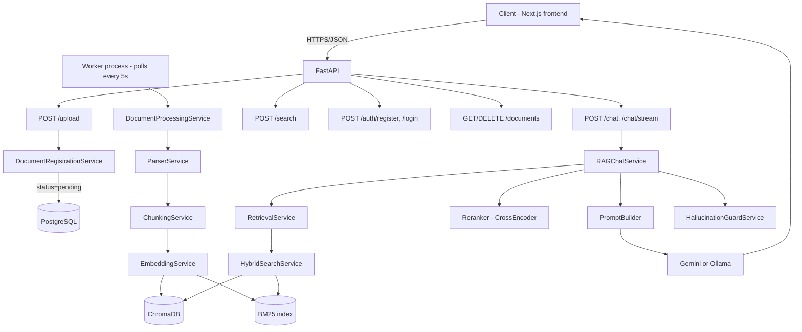

# RAG Chatbot

A Retrieval-Augmented Generation chatbot. A user registers, uploads a
document (PDF, DOCX, or TXT), and asks questions about it. The backend
parses and chunks the document, embeds the chunks, and stores them in a
vector database. When a question comes in, it retrieves the chunks most
relevant to that question (using both semantic and keyword search),
reranks them, and sends them to an LLM (Gemini or Ollama) as context so
the answer is grounded in the uploaded document rather than the model's
general training data.

This README is the map. For exact implementation detail with code
references, see [`docs/`](docs/) — start with
[`docs/RAG_PIPELINE.md`](docs/RAG_PIPELINE.md).

## Architecture



Every box above is a real class in this repository — see
[`docs/ARCHITECTURE.md`](docs/ARCHITECTURE.md) for what each one does,
where it lives, and why.

## Tech Stack

Verified against `requirements.txt` and actual imports (see
[`docs/LIBRARIES.md`](docs/LIBRARIES.md) for the full inventory,
including packages that are installed but not actually used).

| Layer | Technology | Purpose |
|---|---|---|
| API | FastAPI + Uvicorn | HTTP layer, async request handling |
| Validation / config | Pydantic + pydantic-settings | Request/response schemas, `.env`-driven settings |
| Database | PostgreSQL + SQLAlchemy (async) + Alembic | Users, documents, migrations |
| Document parsing | PyMuPDF (`fitz`), python-docx | PDF and DOCX text extraction |
| Chunking | `langchain-text-splitters` | `RecursiveCharacterTextSplitter` |
| Embeddings | `sentence-transformers` (`all-MiniLM-L6-v2`) | Text → 384-dim vectors |
| Vector store | ChromaDB (server mode, `HttpClient`) | Vector storage and similarity search |
| Keyword search | `rank-bm25` (`BM25Okapi`) | Exact-term matching, the other half of hybrid search |
| Reranking | `sentence-transformers` (`CrossEncoder`, `ms-marco-MiniLM-L-6-v2`) | Precision re-scoring of retrieved chunks |
| LLM | `google-generativeai` (Gemini) / `ollama` | Answer generation, per-request selectable |
| Auth | `python-jose` (JWT), `passlib` + `bcrypt` | Registration, login, password hashing |
| Frontend | Next.js (App Router) + TypeScript | Chat UI, streaming via Server-Sent Events |

## RAG Pipeline

1. **Upload** — `POST /upload` saves the file with a UUID name and creates a `documents` row with `status="pending"`; returns immediately (202).
2. **Parse** — a background worker picks up pending documents and extracts plain text (PyMuPDF / python-docx / plain read, by extension).
3. **Chunk** — `RecursiveCharacterTextSplitter` splits the text into ~1000-character pieces with 200-character overlap.
4. **Embed** — each chunk is encoded into a 384-dimension vector by `all-MiniLM-L6-v2`.
5. **Store** — vectors go into ChromaDB; the same chunks are also indexed into a BM25 keyword index.
6. **Question** — `POST /chat` rewrites the question into a standalone query, then expands it into 3 search-query variants.
7. **Retrieve** — each variant is run through hybrid search (weighted vector + BM25 fusion), merged, and deduplicated.
8. **Rerank** — a cross-encoder re-scores the merged candidates; only the top 3 above a relevance threshold survive.
9. **Generate** — the reranked chunks are formatted into a prompt and sent to the configured LLM (Gemini or Ollama).
10. **Guard** — a second LLM call checks whether the answer is actually supported by the retrieved context; if not, it regenerates with a stricter prompt.
11. **Answer** — the final answer, its sources, and a relevance label (Excellent / Good / Weak) are returned to the client — as one JSON response, or revealed progressively over `POST /chat/stream`.

Full detail, with real code references at every step, in
[`docs/RAG_PIPELINE.md`](docs/RAG_PIPELINE.md).

## Documentation

| Document | Covers |
|---|---|
| [`docs/ARCHITECTURE.md`](docs/ARCHITECTURE.md) | Every component: what it is, where it lives, input/output |
| [`docs/RAG_PIPELINE.md`](docs/RAG_PIPELINE.md) | The full pipeline, step by step, with code references |
| [`docs/RETRIEVAL.md`](docs/RETRIEVAL.md) | How retrieval actually works — hybrid search, reranking, scoring |
| [`docs/LLM_INTEGRATION.md`](docs/LLM_INTEGRATION.md) | How the LLM is wired in, prompt construction, grounding |
| [`docs/DATA_FLOW.md`](docs/DATA_FLOW.md) | Diagrams: ingestion flow, query flow, complete flow |
| [`docs/LIBRARIES.md`](docs/LIBRARIES.md) | Every dependency: what, why, alternatives |
| [`docs/INDUSTRY_ALTERNATIVES.md`](docs/INDUSTRY_ALTERNATIVES.md) | What else exists for each layer, and when it's used |
| [`docs/PRODUCTION_EVOLUTION.md`](docs/PRODUCTION_EVOLUTION.md) | What would change at real scale |
| [`docs/DECISIONS.md`](docs/DECISIONS.md) | Why each major technology was chosen |
| [`docs/INTERVIEW_GUIDE.md`](docs/INTERVIEW_GUIDE.md) | Interview-style Q&A about this specific system |
| [`docs/GLOSSARY.md`](docs/GLOSSARY.md) | RAG terminology in plain language |
| [`docs/VIDEO_DEMO_SCRIPT.md`](docs/VIDEO_DEMO_SCRIPT.md) | Narration-ready walkthrough for demoing the app to students |
| [`docs/sprints/`](docs/sprints/) | Sprint-by-sprint build history and every real bug found along the way |

## Project Structure

```
app/
├── main.py                    # FastAPI app, router + middleware registration
├── api/                       # HTTP layer - request/response only
│   ├── upload.py              # POST /upload
│   ├── chat.py                # POST /chat, POST /chat/stream
│   ├── document.py            # GET/DELETE /documents
│   └── routes/                # health.py, search.py (vector.py exists but is not registered)
├── auth/                      # JWT issuance, password hashing, register/login routes
├── core/                      # Settings, logging, AI model registry, rate limiting
├── database/                  # SQLAlchemy models, repositories, session
├── models/                    # Internal Pydantic data shapes (chunks, embeddings, sources)
├── schemas/                   # API request/response contracts
├── services/                  # All business logic - parsing, chunking, embedding,
│                               # retrieval, reranking, prompting, LLM calls
└── worker.py                  # Background process: polls for pending documents

frontend/                      # Next.js chat UI
tests/                         # pytest suite
docs/                          # This documentation set
migrations/                    # Alembic migrations
docker-compose.yml             # Postgres + ChromaDB + app + worker
```

## Getting Started

### Prerequisites

| Tool | Needed for |
|---|---|
| Docker Desktop | Running Postgres + ChromaDB + backend + worker (recommended path) |
| Python 3.11+ | Only if running the backend outside Docker |
| Node.js 20+ and npm | The frontend |
| Ollama (optional) | The default local LLM — skip if using Gemini |

### 1. Clone and configure

```bash
git clone <repository-url>
cd rag-chatbot
cp .env.example .env
cp frontend/.env.example frontend/.env.local
```

In `.env`, set `JWT_SECRET_KEY` (generate with
`python -c "import secrets; print(secrets.token_hex(32))"`). Everything
else has a working default. Set `LLM_PROVIDER=gemini` and
`GEMINI_API_KEY` to use Gemini instead of the default local Ollama.

### 2. Start the backend

```bash
docker compose up -d --build
```

Starts four containers: `app` (`localhost:8000`, Swagger at `/docs`),
`worker`, `db` (Postgres), `chroma` (ChromaDB). Migrations run
automatically.

### 3. Start the frontend

```bash
cd frontend && npm install && npm run dev
```

Open `http://localhost:3000`.

### Running tests

```bash
pytest -v --ignore=tests/test_gemini.py --ignore=tests/test_settings.py \
  --ignore=tests/test_bm25.py --ignore=tests/test_chunker.py \
  --ignore=tests/test_embedding.py --ignore=tests/test_retrieval.py \
  --ignore=tests/test_vector_stats.py --ignore=tests/test_connections.py \
  --ignore=tests/test_llm.py
```

Matches exactly what CI runs (`.github/workflows/ci.yml`); each
exclusion has a documented reason inline in that file.

### Stopping

```bash
docker compose down       # keep data
docker compose down -v    # wipe data
```
