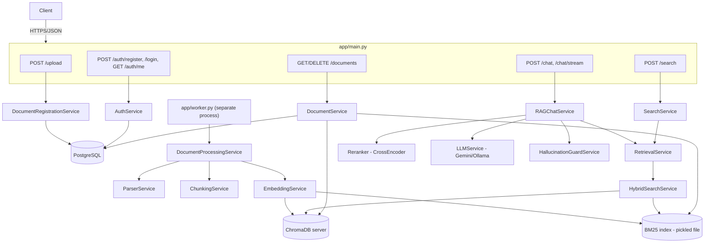

# Architecture

Every component below is verified against the actual source — file paths,
class names, and behavior are copied from the code, not inferred.

## High-Level Architecture

`SearchService` (behind `POST /search`) reuses the same `RetrievalService`
/ `HybridSearchService` as chat, but stops there — no reranking, no LLM
call, no hallucination guard. It returns raw ranked chunks. This is a
separate, simpler retrieval-only endpoint from the full chat pipeline.

## Components

### API Layer

| Component | File | Endpoint(s) | Input | Output |
|---|---|---|---|---|
| Upload router | `app/api/upload.py` | `POST /upload` | Multipart file | `202 {document_id, filename, status, message}` |
| Chat router | `app/api/chat.py` | `POST /chat`, `POST /chat/stream` | `{question, conversation_id?, llm_provider?}` | JSON answer, or Server-Sent Events |
| Documents router | `app/api/document.py` | `GET /documents`, `GET /documents/{id}`, `DELETE /documents/{id}` | — | Document list / single document / delete confirmation |
| Search router | `app/api/routes/search.py` | `POST /search` | `{query, top_k}` | Ranked chunks, no generation |
| Auth router | `app/auth/router.py` | `POST /auth/register`, `POST /auth/login`, `GET /auth/me` | Email/password | User record / JWT / current user |
| Health router | `app/api/routes/health.py` | `GET /health` | — | `{"status": "healthy"}` |

`app/api/routes/vector.py` defines `GET /vectors/stats` but it is **not**
registered in `app/main.py` — the route exists in code but is
unreachable. `app/main.py` also has two leftover placeholder routes:
`GET /` (a welcome message) and `GET /users` (always returns `{"users":
[]}`) — neither is part of the real API surface.

### Document Ingestion

| Component | File | Class | Input | Output |
|---|---|---|---|---|
| Storage | `app/services/storage.py` | `StorageService` | Uploaded file | Saved path (`uploads/<uuid>.<ext>`) |
| Registration | `app/services/document_registration_service.py` | `DocumentRegistrationService` | File + user_id | `Document` row, `status="pending"` |
| Worker | `app/worker.py` | (module-level `run()`) | — (polls DB) | Calls `DocumentProcessingService` every 5s, batch of 5 |
| Processing | `app/services/document_processor.py` | `DocumentProcessingService` | A pending `Document` | Parses, chunks, embeds, indexes; sets `status="completed"` or `"failed"` |
| Parser | `app/services/parser.py` | `ParserService` | File path | Plain text string |
| Chunker | `app/services/chunker.py` | `ChunkingService` | Text | `list[DocumentChunk]` |
| Embedding | `app/services/embedding.py` | `EmbeddingService` | Chunks (or a query string) | `list[DocumentEmbedding]` (or one vector) |
| Vector store | `app/services/vector_store.py` | `VectorStoreService` | Chunks + embeddings | Upserted into ChromaDB |
| BM25 index | `app/services/bm25_search.py` | `BM25SearchService` | Chunks as `BM25Document` | Rebuilt index, pickled to disk |
| Debug artifacts | `app/services/chunk_storage.py`, `app/services/embedding_storage.py` | `ChunkStorageService`, `EmbeddingStorageService` | Chunks / embeddings | JSON files under `chunks/` and `embeddings/` — written but never read back by the app |

**Why upload and processing are split in two:** `DocumentRegistrationService`
runs inside the HTTP request and only saves the file — it returns in
milliseconds regardless of file size. `DocumentProcessingService` (parse →
chunk → embed → index) runs in a **separate worker process** that polls
Postgres for `status="pending"` rows. This means a large PDF can't cause
`POST /upload` to time out, and the memory-heavy embedding model only
needs to fit in the worker process, not the web-facing one.

### Query / Retrieval

| Component | File | Class | Input | Output |
|---|---|---|---|---|
| Chat orchestrator | `app/services/rag_chat.py` | `RAGChatService` | Question, conversation_id, user_id | Answer + sources + evaluation dict |
| Cross-user guard | `app/services/query_access.py` | `QueryAccessService` | Question text, current user_id | `True`/`False` — blocks if the question literally names a different user |
| Query rewrite | `app/services/query_enhancer.py` | `QueryEnhancer` | Question + history | Standalone search query (1 LLM call) |
| Query expansion | `app/services/query_expander.py` | `QueryExpander` | Enhanced query | 3 query variants, JSON array (1 LLM call) |
| Retrieval | `app/services/retrieval.py` | `RetrievalService` | Query embedding(s), user_id | Merged, deduplicated, score-filtered chunks |
| Hybrid search | `app/services/hybrid_search.py` | `HybridSearchService` | Query embedding + query text | Vector + BM25 results fused into one ranked list |
| Vector search | `app/services/vector_store.py` | `VectorStoreService.search()` | Query embedding | ChromaDB nearest-neighbor results |
| Keyword search | `app/services/bm25_search.py` | `BM25SearchService.search()` | Query text | BM25-ranked results |
| Source building | `app/services/source_builder.py` | `SourceBuilder` | Raw retrieval results | `list[SourceReference]` |
| Reranking | `app/services/reranker.py` | `Reranker` | Query + sources | Top 3 sources by cross-encoder score, above threshold |
| Deduplication | `app/services/context_deduplicator.py` | `ContextDeduplicator` | Sources | Sources with exact-duplicate content removed |
| Compression | `app/services/context_compressor.py` | `ContextCompressor` | Question + sources | Sources trimmed to only sentences containing question keywords |
| Context window | `app/services/context_window_manager.py` | `ContextWindowManager` | Sources | Sources trimmed to fit a word-count budget |
| Context formatting | `app/services/context_formatter.py` | `ContextFormatter` | Sources | Labeled text block for the prompt |
| Prompt building | `app/services/prompt_builder.py` | `PromptBuilder` | Question, context, history | Final LLM prompt string |
| LLM | `app/services/llm/gemini.py`, `app/services/llm/ollama.py` | `GeminiService`, `OllamaService` | Prompt | Generated text |
| Hallucination guard | `app/services/hallucination_guard_service.py` | `HallucinationGuardService` | Question, context, answer | `{grounded, confidence, unsupported_claims}` (1 LLM call) |
| Model registry | `app/core/ai_registry.py` | `AIServiceRegistry` | — | Cached singletons: embedding model, reranker, LLM client(s) |
| Search evaluation | `app/services/search_evaluator.py` | `SearchEvaluator` | Question + sources | `{quality: Excellent/Good/Weak, best_score, average_score}` |

### Not wired into the live chat pipeline

These classes exist in the repository but are never imported by anything
the API actually calls:

| Class | File | Status |
|---|---|---|
| `ContextRanker` | `app/services/context_ranker.py` | Defined, never called anywhere |
| `ChatService` | `app/services/chat.py` | An earlier, simpler chat implementation, superseded by `RAGChatService` |
| `PromptBuilder` (a second, different one) | `app/services/prompt.py` | Only used by the unused `ChatService` above — not the same class as `app/services/prompt_builder.py`, which is the one actually used |
| `RAGResponse`, `HallucinationResult` | `app/models/rag_response.py` | Defined Pydantic models, not imported anywhere |
| `SearchEvaluation` | `app/models/search_evaluation.py` | Defined, not imported anywhere (the real evaluation dict is built inline by `SearchEvaluator`, not this class) |
| `RAGEvaluation` | `app/models/rag_evaluation.py` | Defined, not imported anywhere |

`RAGEvaluator` (`app/services/rag_evaluator.py`) **is** called by
`RAGChatService` and returned as the response's `evaluation` field, but
it grades quality more crudely than `SearchEvaluator` (just "Good" if any
score exists, "Weak" otherwise — no threshold tiers). The frontend reads
`search_evaluation` (from `SearchEvaluator`), not `evaluation`.

### Auth & Multi-Tenancy

| Component | File | Class | What it does |
|---|---|---|---|
| JWT issuance | `app/auth/jwt.py` | `create_access_token()` | Signs a 30-minute HS256 token |
| Password hashing | `app/auth/security.py` | `hash_password()`, `verify_password()` | bcrypt via `passlib` |
| Auth business logic | `app/auth/service.py` | `AuthService` | Register/login, password length validation (8–72 bytes) |
| Current-user dependency | `app/auth/dependencies.py` | `get_current_user()` | Decodes the JWT, loads the `User` row |
| Rate limiting | `app/core/rate_limiter.py` | `InMemoryRateLimiter` | 5 attempts / 60s per IP on `/auth/register` and `/auth/login` — in-process only, documented in its own docstring as not effective across multiple worker processes |
| Document ownership | `app/database/repositories/document_repository.py` | `DocumentRepository` | Every document query is filtered by `user_id` |

Document isolation happens at two layers: `DocumentRepository` never
returns a document that doesn't belong to the requesting user (returning
`403`, not `404`, for both "doesn't exist" and "exists but isn't yours" —
so a client can't distinguish the two and enumerate other users' document
IDs), and `RetrievalService` resolves the user's own document IDs from
Postgres *before* any vector or BM25 search runs, so retrieval is scoped
to owned documents structurally, not by filtering results afterward.

### Persistence

| Data | Where | Notes |
|---|---|---|
| Users, documents (metadata + status) | PostgreSQL | Via SQLAlchemy async ORM, Alembic-migrated |
| Vectors | ChromaDB, running as its own server (`docker-compose`'s `chroma` service), reached over HTTP via `ChromaClient` (`app/services/chroma_client.py`) | Single collection named `"documents"` |
| Keyword index | `rank-bm25`'s `BM25Okapi`, pickled to `storage/bm25/index.pkl` (path from `settings.bm25_path`) | Rebuilt from scratch on every add or delete — not incremental |
| Conversation history | In-process Python dict (`InMemoryConversationStore`, `app/services/conversation_store/memory.py`) | Not persisted — lost on restart, not shared across processes |
| Chunk/embedding debug dumps | `chunks/<id>.json`, `embeddings/<id>.json` | Write-only, never read back |
| Uploaded files | `uploads/<uuid>.<ext>` | Original filename kept only in Postgres, not in the stored filename |

## End-to-End Flow

Upload sequence and query sequence are diagrammed separately, as
[`docs/diagrams/ingestion-flow.mmd`](diagrams/ingestion-flow.mmd) and
[`docs/diagrams/query-flow.mmd`](diagrams/query-flow.mmd) — both are
Mermaid source files that render directly on GitHub. See
[`docs/DATA_FLOW.md`](DATA_FLOW.md) for the same diagrams inline with
explanation.
