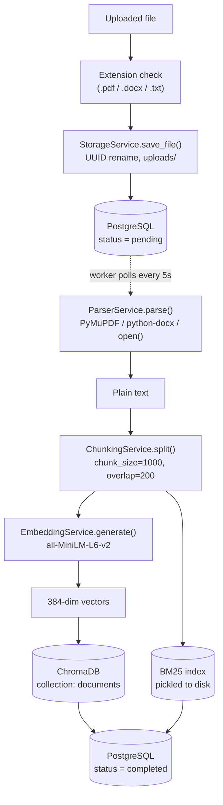
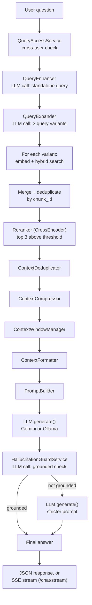
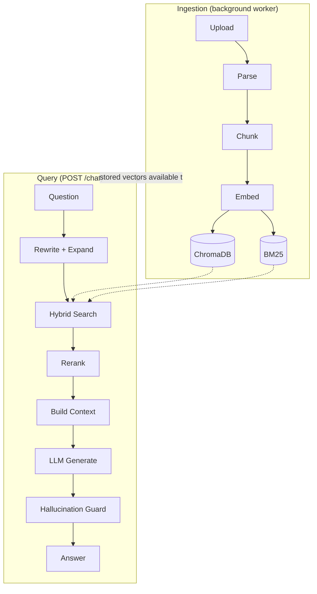

# Data Flow

Visual reference for how data moves through the system. See
[`docs/RAG_PIPELINE.md`](RAG_PIPELINE.md) for the explanation behind each
step, and [`docs/diagrams/`](diagrams/) for these same diagrams as
standalone `.mmd` files.

## Document Ingestion Flow

## Query Flow

## Complete Flow

## Notes on what's shown vs. simplified

- The "Loop" step in the query-flow diagram runs the full hybrid-search
  path (vector + BM25 + fusion + threshold filter) **once per expanded
  query** (3 variants by default) — shown as one box for readability; see
  [`docs/RETRIEVAL.md`](RETRIEVAL.md) for the unrolled version.
- The hallucination guard's regeneration path is a real conditional
  branch, not decorative — it only fires when the guard's LLM call
  returns `grounded: false`.
- Ingestion and query are entirely separate flows running in separate
  processes (worker vs. web app) — the diagrams are drawn separately
  because they don't share a call stack, only shared storage (ChromaDB,
  BM25 index, Postgres).
