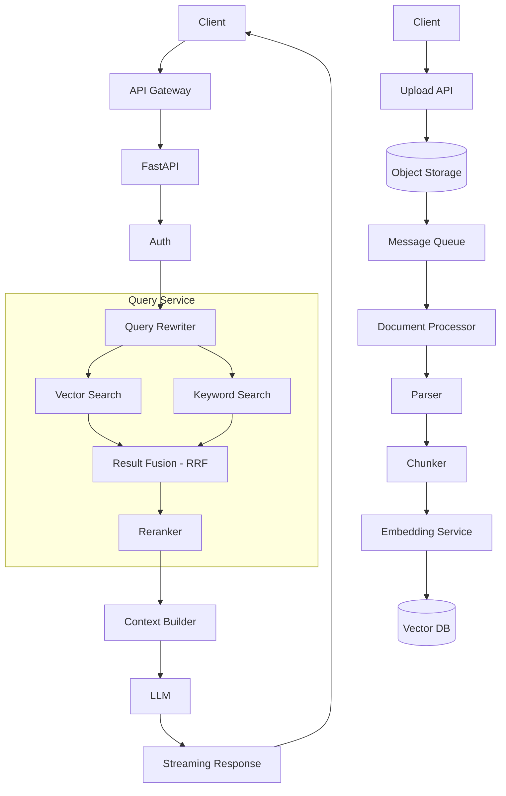

# Production Evolution

How this application could evolve toward a larger-scale deployment. This
document does not rewrite the project — everything under **CURRENT** is
verified from the code; everything under **PRODUCTION EVOLUTION** is a
possible future direction, not something implemented.

## 1. Document Ingestion

> **CURRENT:** `POST /upload` saves the file synchronously
> (`StorageService.save_file()`, local disk under `uploads/`) and creates
> a Postgres row with `status="pending"`. A separate worker process
> (`app/worker.py`) polls Postgres every 5 seconds for pending rows.

> **PRODUCTION EVOLUTION:** Upload directly to object storage (S3 or
> equivalent) instead of local disk, so the app and worker don't need a
> shared filesystem and files survive a container being destroyed.

## 2–3. Async Processing / Queue-Based Processing

> **CURRENT:** Async in the sense that the worker is a separate process
> from the web app, but the handoff between them is a **polling loop**
> (`SELECT ... WHERE status='pending'` every 5s), not a message queue.

> **PRODUCTION EVOLUTION:** Replace polling with a real queue (SQS, Redis
> Streams, RabbitMQ, Kafka) — the upload request publishes a job message,
> workers consume it immediately instead of waiting up to 5 seconds, and
> the queue gives you built-in retry/dead-letter handling instead of the
> current bare `try/except` around each document (`app/worker.py`).

## 4. Object Storage

> **CURRENT:** Files, chunk debug dumps, and embedding debug dumps all
> live on local disk (`uploads/`, `chunks/`, `embeddings/`), inside
> Docker named volumes.

> **PRODUCTION EVOLUTION:** Object storage (S3-compatible) for uploaded
> files, so the app can run as multiple stateless replicas without a
> shared volume.

## 5. PostgreSQL

> **CURRENT:** Already used, for `users` and `documents` metadata, via
> async SQLAlchemy + Alembic migrations.

> **PRODUCTION EVOLUTION:** At larger scale — connection pooling
> (PgBouncer), read replicas for read-heavy endpoints, and a managed
> Postgres service instead of a single container.

## 6. `pgvector` / Managed Vector DB

> **CURRENT:** Self-hosted ChromaDB, single collection, single server
> container, no replication.

> **PRODUCTION EVOLUTION:** A managed vector database (Pinecone, Qdrant
> Cloud, etc.) or `pgvector` if consolidating onto the existing Postgres
> instance — either removes the operational burden of running and
> backing up a dedicated vector store yourself.

## 7. Hybrid Retrieval

> **CURRENT:** Already implemented — vector + BM25, weighted-sum fusion.
> See [`docs/RETRIEVAL.md`](RETRIEVAL.md).

> **PRODUCTION EVOLUTION:** Move fusion to Reciprocal Rank Fusion (scale-
> independent, no hand-tuned weights), and move the BM25 index to a real
> search engine (Elasticsearch/OpenSearch) so it's not a single pickled
> file rebuilt from scratch on every document change.

## 8. Reranking

> **CURRENT:** Already implemented — local cross-encoder
> (`cross-encoder/ms-marco-MiniLM-L-6-v2`), threshold-filtered, top 3.

> **PRODUCTION EVOLUTION:** A hosted reranking API (Cohere Rerank, etc.)
> to avoid running the cross-encoder model on the application server, or
> a larger reranker model if accuracy matters more than latency/cost.

## 9. Query Rewriting

> **CURRENT:** Already implemented — `QueryEnhancer` (standalone-query
> rewrite) and `QueryExpander` (3 query variants), each one real LLM
> call.

> **PRODUCTION EVOLUTION:** Cache rewritten/expanded queries for
> identical or near-identical questions to avoid paying for 2 extra LLM
> calls on every single chat message.

## 10. Metadata Filtering

> **CURRENT:** Filters by `document_id` only (for user ownership).

> **PRODUCTION EVOLUTION:** Filter by upload date, document type, tags,
> or department/team, if the product needs users to scope a question to
> a subset of their documents beyond "all of them."

## 11. Document-Level Access Control

> **CURRENT:** Documents belong to exactly one user
> (`Document.user_id`). `DocumentRepository` never returns another user's
> document (`403`, not `404`, for both "doesn't exist" and "not yours" —
> see [`docs/ARCHITECTURE.md`](ARCHITECTURE.md)). There is no sharing,
> no roles, no per-document permissions beyond "the uploader owns it."

> **PRODUCTION EVOLUTION:** Shared documents, role-based access (viewer/
> editor), or team/organization-level ownership instead of strictly
> per-user.

## 12. Multi-Tenancy

> **CURRENT:** Multi-*user*, not multi-*tenant* — every user's data lives
> in the same Postgres tables and the same ChromaDB collection,
> distinguished only by `user_id` in rows/metadata. There is no
> organization/workspace concept.

> **PRODUCTION EVOLUTION:** A tenant ID threaded through every table and
> every vector's metadata (if serving multiple separate companies from
> one deployment), or fully separate databases/collections per tenant for
> stronger isolation.

## 13. Caching

> **CURRENT:** None. Every chat message re-runs the full pipeline —
> query rewrite, query expansion, hybrid search, reranking, generation,
> and hallucination validation — even for a repeated or near-identical
> question.

> **PRODUCTION EVOLUTION:** Cache embeddings for identical text, cache
> retrieval results for identical queries, or cache full LLM responses
> for identical (question, context) pairs — Redis is the common choice.

## 14. Observability

> **CURRENT:** Structured logging to console + a rotating file
> (`app/core/logger.py`, `logs/rag_chatbot.log`), tagged with a
> per-request ID (`RequestLoggingMiddleware`,
> `app/core/request_context.py`). `MetricsService.record()` logs a
> `RAGMetrics` object (retrieval time, LLM time, hallucination-check
> time, chunk counts) for every chat request — but only to the log file,
> not to any metrics system.

> **PRODUCTION EVOLUTION:** Ship logs to a log aggregator (e.g. the ELK
> stack, or a hosted log platform), export metrics to Prometheus/Grafana
> or an APM tool, and add distributed tracing (OpenTelemetry — already a
> transitive dependency in `requirements.txt` via other packages, but not
> wired into this app's own code) so a single request can be traced
> across the web process, worker process, ChromaDB, and the LLM API call.

## 15. Evaluation

> **CURRENT:** No retrieval-quality or answer-quality evaluation exists
> in this codebase. `SearchEvaluator`/`RAGEvaluator` grade a *single
> request's* best similarity score into a label (Excellent/Good/Weak) —
> that's a per-request confidence signal, not an evaluation framework
> that measures quality across a labeled test set.

> **PRODUCTION EVOLUTION:**
> - Retrieval metrics: Recall@K, Precision@K, MRR, NDCG — computed
>   against a labeled set of (question, correct chunk) pairs.
> - Generation metrics: faithfulness (does the answer only claim what the
>   context supports — this project's hallucination guard is a real-time,
>   per-request version of this idea, not an offline evaluation metric),
>   answer relevance, context relevance.

## 16. Rate Limiting

> **CURRENT:** `InMemoryRateLimiter` (`app/core/rate_limiter.py`) limits
> `/auth/register` and `/auth/login` to 5 attempts per 60 seconds per IP.
> Its own docstring documents the real limitation: it's in-process, so it
> doesn't enforce a global limit across multiple worker processes. There
> is **no rate limiting on `/chat` or `/upload`** — nothing stops a user
> from sending unlimited chat messages (each of which can trigger up to 5
> LLM calls).

> **PRODUCTION EVOLUTION:** A shared rate limiter (Redis-backed) covering
> every endpoint, with per-user (not just per-IP) limits, and specific
> limits on LLM-cost-incurring endpoints like `/chat`.

## 17. Authentication

> **CURRENT:** JWT (HS256, 30-minute expiry, `python-jose`), password
> hashing via bcrypt/passlib. No refresh tokens, no email verification,
> no password reset flow, no OAuth/SSO.

> **PRODUCTION EVOLUTION:** Refresh tokens, email verification, password
> reset, and OAuth/SSO (Google/Microsoft login) for enterprise
> deployments.

## 18. Streaming LLM Responses

> **CURRENT:** `POST /chat/stream` reveals the *already-generated* answer
> word-by-word over Server-Sent Events — not real token-level LLM
> streaming, since the hallucination guard needs the complete answer
> before it can validate it. See
> [`docs/RAG_PIPELINE.md`, section 13](RAG_PIPELINE.md#13-final-answer).

> **PRODUCTION EVOLUTION:** True token streaming would mean either
> accepting the hallucination guard only validates *after* the user has
> already seen the streamed answer (weakening the guarantee), or
> streaming a separate, unguarded "draft" while the guarded version is
> still computed — a real product trade-off, not just an engineering one.

## 19–20. Retries / Circuit Breakers

> **CURRENT:** None. A failed LLM call fails the request. A failed
> ChromaDB or database call raises and is logged
> (`VectorStoreService.search()` re-raises after logging; the worker's
> per-document `try/except` in `app/worker.py` keeps the poll loop alive
> but does not retry the same document automatically beyond it staying
> `"failed"` until someone re-uploads it).

> **PRODUCTION EVOLUTION:** Retry-with-backoff around transient failures
> (a dropped connection to ChromaDB, a rate-limited LLM call), and a
> circuit breaker around the LLM call so a sustained outage fails fast
> instead of piling up slow, doomed requests.

## 21. Horizontal Scaling

> **CURRENT:** Single `uvicorn` process for the web app, single worker
> process. The embedding model, reranker, and LLM client are process-
> local singletons (`AIServiceRegistry`) — running multiple web replicas
> would mean each one loads its own copy of the embedding model and
> reranker into memory.

> **PRODUCTION EVOLUTION:** Multiple web app replicas behind a load
> balancer, multiple worker replicas consuming from a shared queue (see
> #2–3), and a shared cache (see #13) so replicas don't duplicate
> redundant work.

## Future Architecture

> **INDUSTRY / EVOLUTION ARCHITECTURE — not implemented.**

This differs from the current implementation in: a queue instead of
polling, object storage instead of local disk, RRF instead of
weighted-sum fusion, and true streaming instead of a post-hoc reveal —
everything else (parser → chunker → embedder → vector DB → hybrid search
→ rerank → LLM) is the same shape this project already has.
