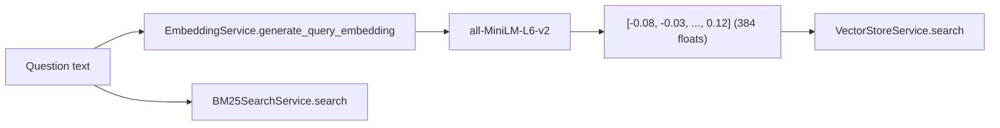
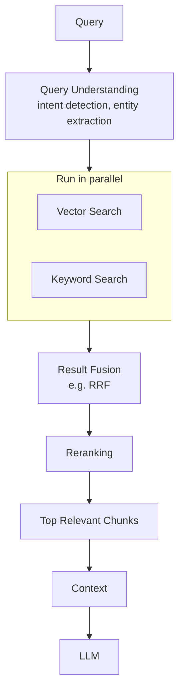

# Retrieval

Focused explanation of how a question becomes a set of relevant chunks in
this specific codebase.

## What is retrieval?

Given a question, find the pieces of previously-stored text most likely
to contain the answer, without reading through every document. This
project's retrieval is **hybrid**: it combines a semantic (vector)
search with a keyword (BM25) search and merges the results.

## Current retrieval implementation

> **CURRENT:** Hybrid search (vector + BM25, weighted-sum fusion) +
> cross-encoder reranking. Not pure vector search, not keyword-only.

```
Query
    ↓
Query Embedding (all-MiniLM-L6-v2)
    ↓
┌─────────────────────┬─────────────────────┐
│   Vector Search      │   BM25 Search        │
│   (ChromaDB)          │   (rank_bm25)         │
└─────────────────────┴─────────────────────┘
    ↓                         ↓
Normalize scores (both to 0-1 range)
    ↓
hybrid_score = 0.6 * vector_score + 0.4 * bm25_score
    ↓
Filter: hybrid_score >= 0.30
    ↓
Cross-Encoder Reranking (top candidates only)
    ↓
Filter: rerank_score >= 0.20
    ↓
Top 3
```

Files: `app/services/retrieval.py` (`RetrievalService`),
`app/services/hybrid_search.py` (`HybridSearchService`),
`app/services/vector_store.py` (`VectorStoreService`),
`app/services/bm25_search.py` (`BM25SearchService`),
`app/services/reranker.py` (`Reranker`).

## Query → Embedding → Search



The question and every stored document chunk are embedded by the exact
same model (`all-MiniLM-L6-v2`) — comparing vectors only makes sense when
they come from the same model.

## Similarity

**This project does not compute cosine similarity directly.** ChromaDB's
collection is configured for **L2 (Euclidean) distance**
(`'hnsw': {'space': 'l2', ...}` — logged by `VectorStoreService.__init__`
from the live collection config), and `HybridSearchService` converts that
raw distance into a 0–1 score with its own formula:

```python
def _normalize_distance(self, distance: float):
    distance = max(0.0, float(distance))
    return 1.0 / (1.0 + distance)
```

In simple terms: smaller distance (vectors that are close together in
384-dimensional space) means a bigger similarity score, and the formula
squashes any non-negative distance into the range (0, 1].

**Cosine similarity, for reference** (not what this code computes, but
the formula most commonly associated with embedding search):

```
cosine_similarity(A, B) = (A · B) / (||A|| × ||B||)
```

- `A · B` — the dot product: multiply matching positions of the two
  vectors and add them up.
- `||A||`, `||B||` — the length (magnitude) of each vector.
- The result is between -1 and 1; 1 means the vectors point in exactly
  the same direction (most similar).

BM25's own score (`app/services/bm25_search.py`, via `BM25Okapi.get_scores()`)
is a different kind of number entirely — a keyword-weighting score with
no fixed range — which is why `HybridSearchService` normalizes it
separately, by dividing every result's score by the maximum score in
that result set:

```python
result["score"] = result["score"] / max_score
```

## Top-K

Multiple, different top-K values exist at different stages — there is no
single "the" top-K:

| Setting (`app/core/config.py`) | Value | Applies to |
|---|---|---|
| `top_k_vector` | 10 | Candidates returned by ChromaDB before fusion |
| `top_k_bm25` | 10 | Candidates returned by BM25 before fusion |
| `hybrid_top_k` | 10 | Candidates `HybridSearchService` keeps after fusion |
| `retrieval_top_k` | 5 | What `RetrievalService.retrieve()` requests from hybrid search |
| *(hardcoded, not a setting)* | 3 | `Reranker.rerank()`'s final `ranked[:3]` — note: `settings.rerank_top_k` also exists and is also `3`, but the reranker does not actually read it; the `3` in the code is a literal |

Because `POST /chat` calls `multi_retrieve()`, which runs retrieval
**once per expanded query** (3 variants — see
[`docs/RAG_PIPELINE.md`](RAG_PIPELINE.md#9-relevance-and-context-selection)),
the number of chunks reaching the reranker is usually larger than any
single top-K value above, until deduplication and reranking narrow it
back down to 3.

## Relevance

`SearchEvaluator.evaluate()` (`app/services/search_evaluator.py`) grades
the *best* surviving source's score:

```python
best_score >= 0.7 → "Excellent"
best_score >= 0.5 → "Good"
else              → "Weak"
```

This is what the frontend displays (`search_evaluation.quality`).

## Metadata filtering

**Implemented, and load-bearing for multi-user isolation.**
`VectorStoreService.search()` applies a Chroma `where` filter:

```python
where = {"document_id": document_ids[0]}                                # one document
where = {"$or": [{"document_id": d} for d in document_ids]}             # multiple documents
```

`document_ids` comes from `DocumentRepository.get_user_document_ids(user_id)`
— resolved from Postgres before any vector/BM25 call — so a user's search
is structurally restricted to their own documents; it isn't filtered out
of a shared result set afterward. `BM25SearchService.search()` applies
the equivalent filter on its own side, by `document_id` string match.

There is no other metadata filtering (e.g. by upload date, file type, or
custom tags) implemented — only document ownership.

## Reranking

**Implemented.** See [`docs/RAG_PIPELINE.md`, section 9](RAG_PIPELINE.md#9-relevance-and-context-selection)
for the full mechanism. In one line: a `CrossEncoder`
(`cross-encoder/ms-marco-MiniLM-L-6-v2`) re-scores the hybrid-search
shortlist by reading the query and each candidate chunk *together*, which
is more accurate than the independent scoring hybrid search does, but too
slow to run against every stored chunk — hence running it only on the
shortlist.

## A note on threshold settings that exist but are not wired up

`app/core/config.py` defines several threshold-shaped settings that are
**never actually read anywhere else in the codebase** — they exist, have
plausible defaults, but have no effect:

| Setting | Default | Reality |
|---|---|---|
| `vector_distance_threshold` | 0.75 | Not referenced outside its own definition |
| `vector_similarity_threshold` | 0.25 | Not referenced outside its own definition |
| `hallucination_threshold` | 0.75 | Not referenced outside its own definition — the hallucination guard uses the LLM's own `grounded` boolean, not a numeric threshold comparison |
| `rerank_top_k` | 3 | Not referenced — `Reranker.rerank()` hardcodes `[:3]` directly |

The filtering that genuinely happens is driven by `hybrid_score_threshold`
(0.30, in `HybridSearchService` and again, redundantly, in
`RetrievalService._filter_by_score()`) and `reranker_score_threshold`
(0.20, in `Reranker.rerank()`).

## Hybrid Search

Already covered above and in
[`docs/RAG_PIPELINE.md`, section 8](RAG_PIPELINE.md#8-hybrid-search) in
full detail, including how this project's weighted-sum fusion differs
from Reciprocal Rank Fusion (RRF).

## Production Retrieval Architecture

> **INDUSTRY / EVOLUTION ARCHITECTURE — not what this repository
> currently runs.** This is a common shape for retrieval at larger scale
> and with more query understanding than this project currently has.



This project already has the "vector + keyword → fusion → reranking"
shape (sections above) — what it does **not** currently have, compared to
this diagram, is a dedicated query-understanding stage beyond the LLM
based rewriting/expansion it already does (`QueryEnhancer`,
`QueryExpander` — see [`docs/RAG_PIPELINE.md`](RAG_PIPELINE.md)), and its
fusion is weighted-sum rather than rank-based (RRF).
